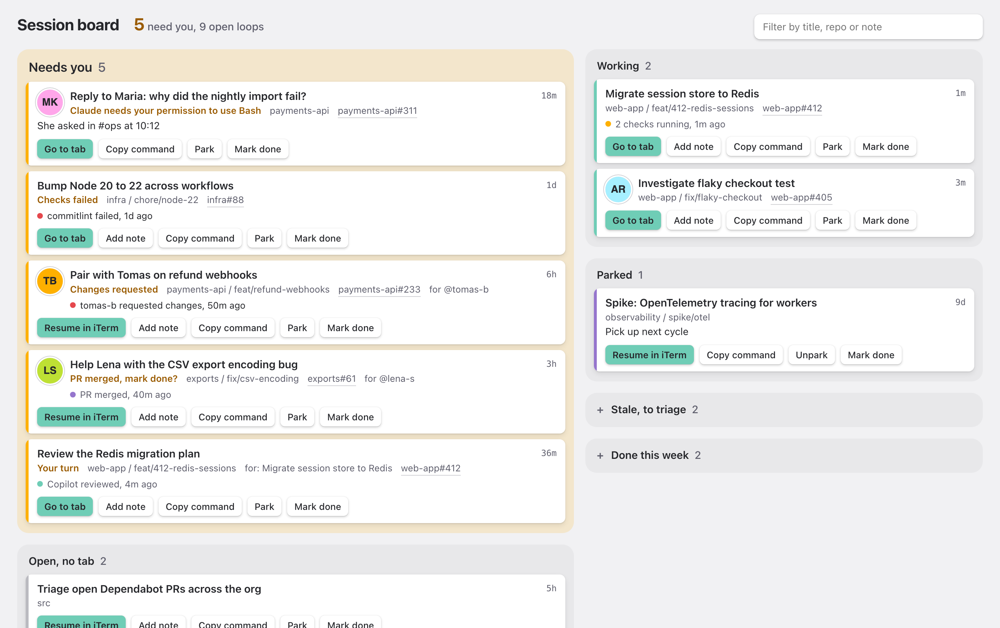
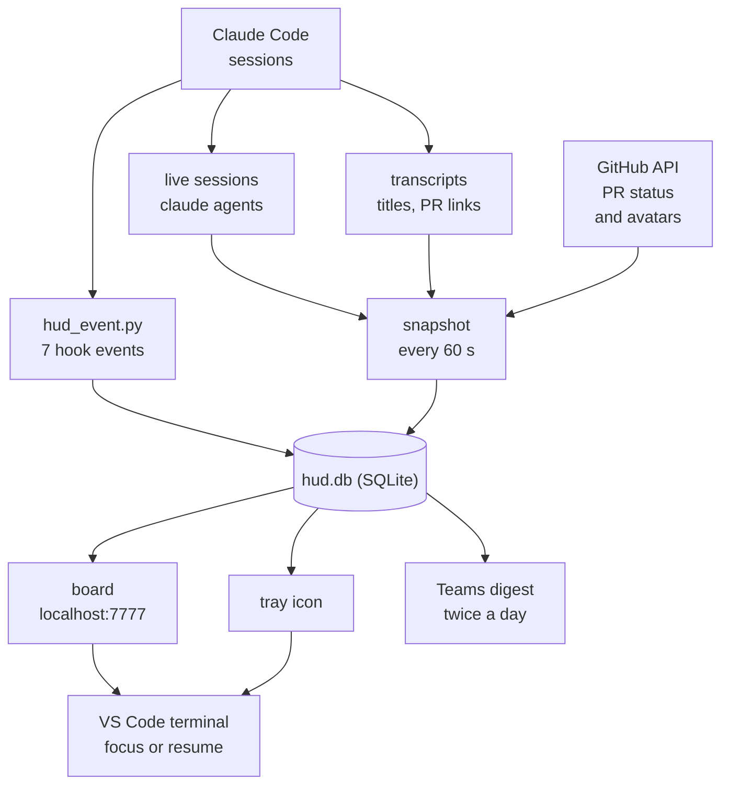

# cc-hud

> Windows port of cc-hud by Johan Andersson ([anderssonjohan/cc-hud](https://github.com/anderssonjohan/cc-hud)),
> based on his commit `f31528d`. The idea, the design, and most of the code are his. This port swaps the macOS
> parts for Windows ones (VS Code terminals, Task Scheduler, a tray icon and a Teams digest) and runs on Windows 10
> and 11. Released under the MIT license, like the original.

Close your Claude Code tabs whenever you like. The work stays on the board until you tick it off.

<picture>
  <source media="(prefers-color-scheme: dark)" srcset="docs/board-dark.png">
  
</picture>

## Why

I used to forget about Claude Code sessions. The computer rebooted, or I lost my terminal tabs for some other reason, and whatever was in them was gone from my head. Some of it was a reply I owed someone.

With cc-hud, closing a tab and finishing the work are two different things. I close tabs freely to clean up my screen. The session stays on the board, one click from resuming, until I explicitly mark it done.

## What you get

- **A board** at `http://localhost:7777`, opened from the tray icon or with `hud.py board`. Sessions are grouped into Needs you, Working, Open (no tab), Parked, Stale and Done this week (struck through). Each has a note field and a filter.
- **Go to tab** brings the VS Code window and terminal of a live session to the front. **Resume in VS Code** opens a closed session in a new `claude` terminal, in the right folder.
- **A tray icon** with the number of sessions that need you. Click a session in its menu to jump to it: the menu item runs `hud.py go <id>`, which focuses the live terminal or resumes the session in VS Code.
- **A Teams digest** twice a day. It lists sessions waiting on you for over an hour, and open sessions untouched for a day, unless their next step is a wait. A board you have to remember to open fails the same way idle tabs do, so this one comes to you.
- **PR status on each session.** A session's strip shows the last thing that happened on its pull request: `commitlint failed, 5m ago`, `2 checks running`, `Copilot reviewed, 1m ago`. Claude Code records which PRs a session opened or pushed to, so this works without any setup in your sessions. When a closed tab's PR goes red, gets changes requested or is merged, the session moves to Needs you. A merged PR asks whether you want to mark the session done.
- **Faces of the people you're helping.** When a session is about a GitHub PR or issue, its strip shows the avatar of whoever opened it and links to it. Your own PRs show an assignee instead, or no face. The session is taken to be about the first PR or issue linked in your prompts; when that link was only an example, `hud.py ref` sets the right one.
- **Work that survives `/clear`.** Clearing a session to hand the work on to a fresh one keeps it on the board: the new session takes over the card, with its note and PR status. Close the card with `/done` when the work is finished, not when the context is.
- **Steps, with the waits ticked for you.** `/steps` turns what is left into a list on the card, shown as `2/4 next: trigger the downstream release`. A step that waits for a PR to merge, or for the first release after the steps before it, ticks itself. When the wait comes through and the next step is yours, the card moves to Needs you.
- **`/done`** inside any session marks it done. `/done park back next cycle` parks it with a note. Typing in a done or parked session reopens it.

Claude Code's own `claude agents` shows what is live right now. cc-hud remembers the rest: closing a tab or rebooting only moves a session to "Open, no tab".

## How it works



- A hook on seven lifecycle events records each session's live state: working, waiting for input, idle, or gone. It never fails the session. If a hook run fails, the error goes to `~/.claude/hud/hook-errors.log`.
- A scheduled task reconciles against `claude agents --json` every minute and reads titles from the transcripts. That catches anything the hooks miss, such as a reboot.
- On first install, the last 30 days of transcripts are imported as Stale. You triage them once instead of starting with a wall of open sessions.

The board loads nothing from the internet. Two things do leave your machine:

- The snapshot job asks the GitHub API, with the `GITHUB_PERSONAL_ACCESS_TOKEN` from your `~/.claude/settings.json`, who opened each PR or issue your sessions link to, and downloads their avatar once into `~/.claude/hud/avatars/`. It also polls the state of those PRs, and of the PRs and releases your steps wait for: one GraphQL request a minute at most, covering only open and parked sessions, and less often for sessions and steps you haven't touched in two days.
- The optional digest goes to your own Teams Workflows webhook. It contains each session's name, or else the title Claude generated for it (a short summary of the conversation), plus repo folder names and ages. Your prompt text itself is never sent.

## Requirements

- Windows 10 or 11.
- VS Code, with `code` on your `PATH`.
- A Claude Code version that has `claude agents --json`, with `claude` on your `PATH`.
- Python 3.11 or later.
- Poetry 2. If `poetry --version` shows 1.x, run `poetry self update` or `pipx upgrade poetry`.
- Optional: a `GITHUB_PERSONAL_ACCESS_TOKEN` in the `env` section of `~/.claude/settings.json`, for avatars and PR status, and a Teams Workflows webhook for the digest.

## Install

```powershell
git clone https://github.com/karim-albeni/cc-hud-win.git
cd cc-hud-win
powershell -ExecutionPolicy Bypass -File .\install.ps1
```

The script is safe to re-run. It stops if the repo path contains a space, so clone to a path like `C:\work\cc-hud-win`. It changes these things:

- Runs `poetry install` to create the virtual environment in `.venv`.

- Adds the hook to seven events in `~/.claude/settings.json`. It saves a backup as `settings.json.bak-cc-hud` first.
- Installs `/done` and `/steps` into `~/.claude/commands/`, unless you already have different commands with those names.
- Installs the VS Code extension that lets the board find your terminals.
- Registers the `cc-hud:` URL protocol for your user. Go to tab and Resume on the board use it. The first time you click one, the browser asks whether to allow opening it.
- Creates four scheduled tasks:
  - `cc-hud-server` and `cc-hud-tray` start at logon and are triggered again every 5 minutes. The trigger does nothing while they run, so a crash recovers on its own.
  - `cc-hud-snapshot` runs every minute.
  - `cc-hud-digest` runs at 09:00 and 13:30, when your computer is available.

For the Teams digest, create a webhook in Teams:

1. Open Workflows and choose "Post to a chat when a webhook request is received".
2. Choose your own chat.
3. Copy the URL the workflow gives you.
4. Run `.venv\Scripts\python.exe hud.py set-webhook` and paste the URL. It goes into Windows Credential Manager, not into a file.

To remove the hooks, commands, extension, protocol and scheduled tasks, run `powershell -ExecutionPolicy Bypass -File .\install.ps1 -Uninstall`. Your data in `~/.claude/hud/` stays, and so does `settings.json.bak-cc-hud`, your settings from before the first install.

Windowless runs write their output to `~/.claude/hud/<subcommand>.log`.

## First run checklist

After the first install, check these once:

1. Open `~/.claude/settings.json` and confirm the hook command is quoted, so a path with spaces still works.
2. Start `claude` in a VS Code terminal and type a prompt. Within 60 seconds the session shows on the board under Working, then under Needs you when Claude stops.
3. Close that terminal. The session moves to "Open, no tab". Click "Resume in VS Code" and confirm a `claude` terminal resumes it.
4. Click "Go to tab" on a live session in another VS Code window. Confirm that terminal comes forward.
5. In a VS Code terminal, run `claude agents --json --all` and confirm your session is in the output. Go to tab needs it.
6. Run `/done` in a session. It should move to Done this week.
7. Run `/steps` with one manual step and one `--pr` step. The card should show `0/2`.
8. Run `.venv\Scripts\python.exe hud.py digest --waiting-hours 0 --cold-hours 0`. The card should appear in your Teams chat. Check that a title containing `*` or `(` shows those characters as typed, with no backslashes. If backslashes show, Teams does not honor Markdown escapes in this card. Change `teams.escape` to remove those characters instead.
9. Run the installer a second time. Confirm there is still only one tray icon.
10. Reboot. After you log on, the tray icon and board should come back, and the sessions from before the reboot should be under "Open, no tab".

## Command line

```
hud.py ls [-a]                  open and parked sessions (-a adds stale and done)
hud.py done [id] [-m note]      mark done; with no id, the session you run it from
hud.py park [id] [-m note]
hud.py open [id]
hud.py note "text" [-s id]
hud.py link <other> [-s id]     show that this session works for another one (a reviewer tab)
hud.py ref <url|none> [-s id]   set the PR or issue the session is about (also owner/repo#12)
hud.py split [id]               take a session out of the work /clear joined it to
hud.py step add "text"          add a step; --pr owner/repo#12 or --release owner/repo[@v2.*] waits instead
hud.py step done|undo|rm <n>
hud.py step ls
hud.py go <id>                  focus the session's tab, or resume it in a new one
hud.py board [-p]               open the board signed in (-p prints the URL)
hud.py resume <id> [-p]         resume in a new VS Code terminal (-p prints the command)
hud.py digest [-n]              post the digest to Teams (-n prints it instead); --waiting-hours, --cold-hours set the thresholds
hud.py set-webhook              store the Teams webhook URL in Credential Manager
hud.py backfill [--days 30]
```

An id can be a session id prefix, a background session id or a session name.

## Configuration

| Variable | Default | |
|---|---|---|
| `HUD_DB` | `~/.claude/hud/hud.db` | Where the ledger lives. Set it with `setx HUD_DB "C:\path\hud.db"`, open a new shell, then run `install.ps1`, so the hooks and scheduled tasks get it too |
| `HUD_TEAMS_WEBHOOK` | | Webhook URL for a manual `hud.py digest`. Without it, the digest reads the URL that `set-webhook` stored in Credential Manager |
| `HUD_BACKFILL_DAYS` | `30` | History imported on first install. Set it before the first install, since only that run imports history |

Automation accounts that look like people (a CI user, say) can be hidden from avatars: put their logins in `~/.claude/hud/ignore-logins`, one per line. Accounts GitHub marks as bots are skipped anyway.

The digest runs at 09:00 and 13:30. Change the times in `install.ps1` and re-run it.

## Security

The board listens on `127.0.0.1` only, but other things can still reach that port, such as a dev container. So everything except the empty page needs a per-install token from `~/.claude/hud/token`. The tray icon and `hud.py board` open the board as `/#t=<token>`; the page keeps the token in that origin's local storage and sends it as a header.

On top of that, requests must carry a `localhost` or `127.0.0.1` Host header, which blocks DNS rebinding, and every request that changes something needs a custom header, so other web pages can't drive the board from your browser. Responses can't be framed or read cross-origin.

## Tips

- Name your sessions: `claude -n "reply to Maria: nightly import"`. A name you chose beats a generated title when you scan the board a week later.
- Before you `/clear`, run `/steps` with what is left. The waits then watch themselves, and the next session starts from the list instead of from memory.
- Park what you won't touch today. "Needs you" only works as a signal if it stays short.

## Development

The tools run from a Poetry project. The app itself uses only the Python standard library, so the lock file holds just ruff and ty.

```powershell
poetry install
poetry run ruff check .
poetry run ruff format --check .
poetry run ty check
poetry run python -m unittest discover -s tests
powershell -ExecutionPolicy Bypass -File tests\hook-smoke.ps1
```

The smoke script sends real hook payloads to a scratch database.
